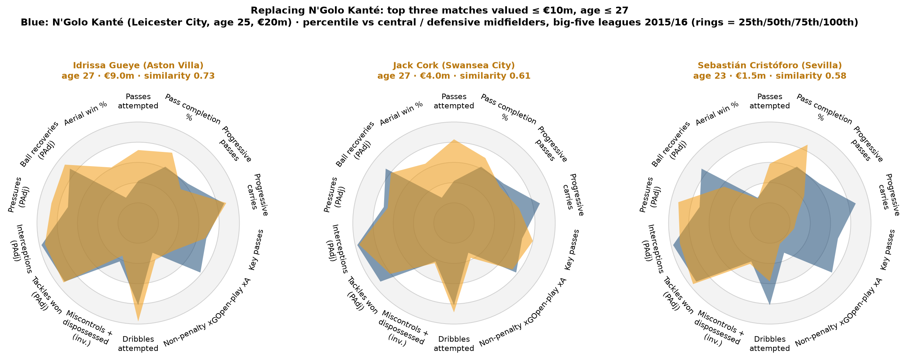
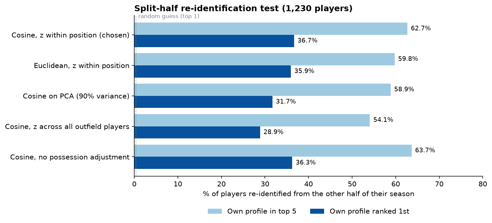
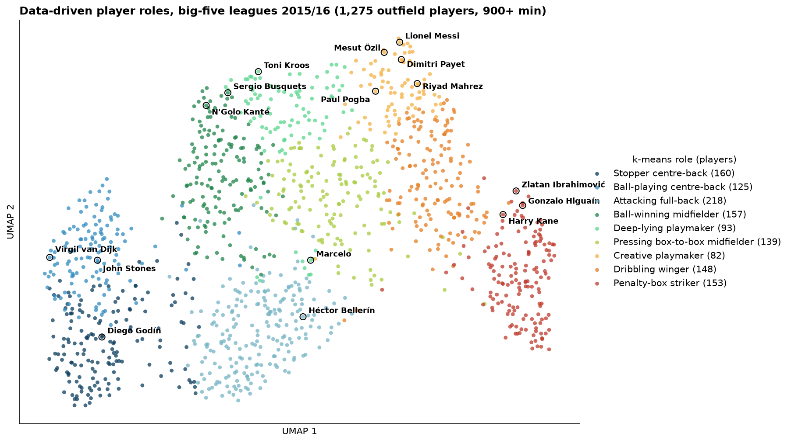
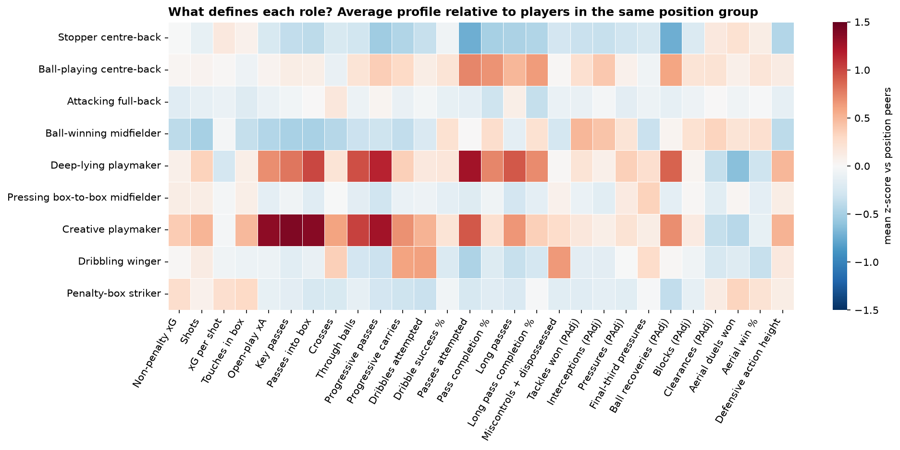
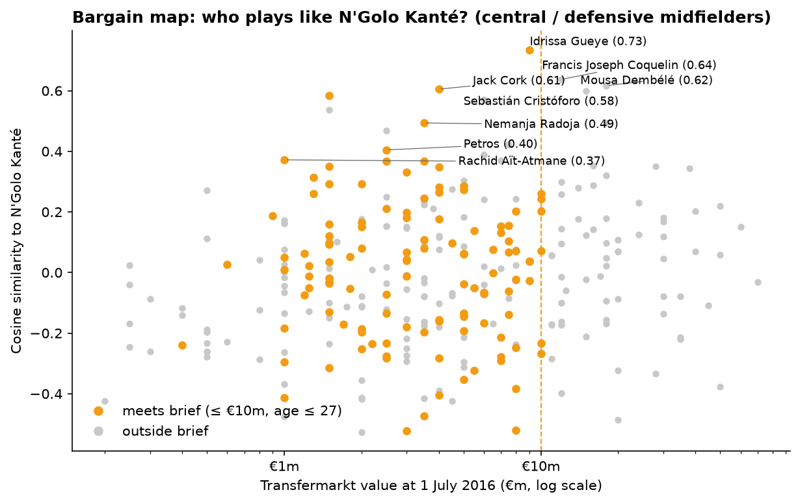
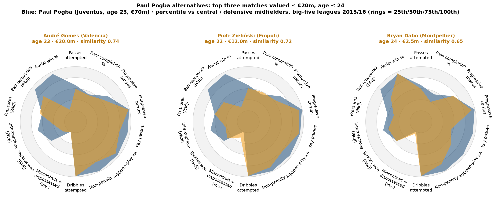
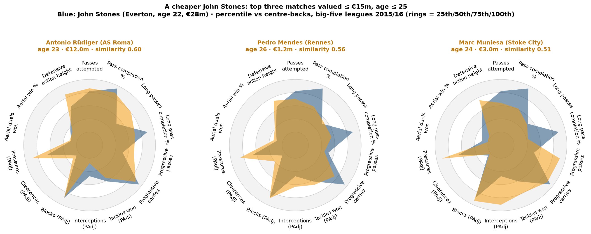
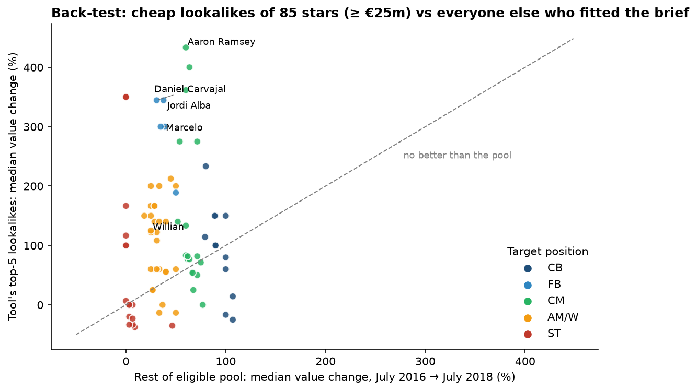

# Player Recruitment & Similarity Scouting Tool

**"Find me someone who plays like X, but cheaper or younger": a position-aware player similarity tool built on StatsBomb event data and Transfermarkt market values, tested against the summer 2016 transfer window.**

*Anthony Adusei-Poku · MSc Data Science, University of East London (2025)*

    -lightgrey)

<p align="center"></p>

## TL;DR

* Built **28-metric per-90 profiles** (shooting, chance creation, progression, possession, possession-adjusted defending, aerial) for **1,275 outfield players with 900+ minutes**, from **1,551 matches** of StatsBomb 2015/16 event data covering the Premier League, La Liga, Serie A and Ligue 1, plus 34 Bundesliga matches.
* Linked **99.9% of StatsBomb player minutes** to Transfermarkt (dates of birth, market values) by matching clubs on fixtures and players on name plus minutes played.
* Similarity is **cosine similarity on z-scores within each position group**. In a split-half test, a player's profile from half his matches picks out *his own* profile from the other half **36.7% of the time first and 62.7% of the time in the top 5**, against 0.4% by chance. This method beat Euclidean distance, PCA and all-player standardisation.
* The search finds the deals clubs actually did. **Kanté's** closest match under €10m was **Idrissa Gueye** (similarity 0.73, €9m), whom Everton signed for €8.5m on 2 August 2016, 17 days after Kanté joined Chelsea. **Pogba's** closest matches under €20m included **André Gomes** and **Piotr Zieliński**, who joined Barcelona and Napoli that summer. **Stones's** closest match under €15m was **Antonio Rüdiger**, who joined Chelsea a year later for €35m.
* **Back-test:** for 85 stars valued at €25m or more, the tool's cheap lookalikes (≤ ⅓ of the price, age ≤ 24) rose more in Transfermarkt value by July 2018 than the rest of the eligible pool for **71.8% of targets**. Counting each player once, being picked by the tool was linked to **×1.27 higher value growth** after controlling for starting value, age and minutes (95% CI ×1.05 to ×1.56).
* Also included: k-means **role clustering** (9 roles, UMAP map), radar charts, a reusable `find_similar()` function, a CLI, and a small **Streamlit app**.

## 1. Problem

Recruitment usually starts from a player the club already knows: a departing starter, or a star it cannot afford.
The analyst's job is to turn "someone like him" into a shortlist: players with a similar *statistical style* who are
cheaper, younger or in a league the club can scout. This project builds that pipeline from public data and checks two
things: whether the similarity measure captures stable player traits, and whether its recommendations make football
sense and would have been good business.

## 2. Data

| Source | What it gives | Coverage used |
|---|---|---|
| [StatsBomb Open Data](https://github.com/statsbomb/open-data) | Event data: every pass, carry, shot, pressure, duel, etc. with locations; lineups with minutes by position | 2015/16 **Premier League (380 matches), La Liga (380), Serie A (380), Ligue 1 (377 of 380)**; **Bundesliga 34 matches** (every released match involves Bayer Leverkusen) |
| [transfermarkt-datasets](https://github.com/dcaribou/transfermarkt-datasets) (CC0) | Dates of birth, market value history, transfers, appearances | Snapshot current to July 2026; values used are the latest on or before **1 July 2016** |

* **43,044 player-match rows**, 2,513 players from 100 clubs. Raw event files (~3-4 MB per match) are processed on the fly and never stored.
* **Linking:** clubs are matched by finding the Transfermarkt game on the same date whose two club names best match each StatsBomb fixture. Players are then matched inside each club's 2015/16 squad by name similarity (accents stripped, nicknames used) combined with agreement in minutes, using the Hungarian algorithm. 2,671 of 2,675 player-club records were linked (99.9% of minutes). For 91% of linked records outside the Bundesliga, the two sources' minutes agree within 20%.
* Of the 1,275 profiled players, 1,273 have a summer-2016 market value and 1,272 a date of birth. The median valuation used was 143 days old on 1 July 2016.

> **Why 2015/16?** It is the most recent season with *full-league* event data for several top divisions that is
> freely and legally available. Free sources for recent seasons either lack event-level data or forbid scraping. The
> upside is that the tool can be **back-tested**: we know what happened to these players afterwards.

> Data © StatsBomb, used under the [StatsBomb Open Data licence](https://github.com/statsbomb/open-data/blob/master/LICENSE.pdf).
> Transfermarkt-derived data from `transfermarkt-datasets` (CC0). Raw data is not included in this repository; the scripts in `src/` recreate it.

## 3. Method

### Player profiles (per 90 minutes, minimum 900 minutes)
| Family | Metrics |
|---|---|
| Shooting | non-penalty xG (StatsBomb), shots, xG per shot, touches in the box |
| Creation | open-play xA (xG of shots assisted), key passes, completed passes into the box, crosses, through balls |
| Progression | progressive passes and carries (ball moved ≥ 25% closer to goal), dribbles attempted, dribble success % |
| Possession | passes attempted, pass completion %, long passes and completion %, miscontrols + times dispossessed |
| Defending | tackles won, interceptions, pressures, ball recoveries, blocks, clearances (all **possession-adjusted**), final-third pressures, average height of defensive actions |
| Aerial | aerial duels won, aerial win % |

* **Position-aware.** Each player is assigned to the group where he played most minutes (CB, FB, CM, AM/W, ST; goalkeepers excluded), and every metric is converted to a z-score **within that group**.
* **Possession-adjusted defending.** Each match's defensive counts are multiplied by 0.5 ÷ the opponent's share of passes, so a Barcelona or PSG defender isn't penalised for having less defending to do. Thiago Silva, for example, moves from 97th to 33rd among centre-backs for interceptions.
* **Small-sample shrinkage.** Success percentages are shrunk towards the league-wide rate with 10 pseudo-attempts, and xG per shot towards 0.10 with 3 pseudo-shots.
* **Similarity.** Cosine similarity between z-score vectors (1 = identical style). `find_similar()` then filters by Transfermarkt value, age and league.

### Validation: does the profile capture a stable style?
Each player's matches were split alternately into two halves (1,230 players with 450+ minutes in each). For every
player, all same-position players were ranked from the *other* half of the season. A random guess finds the right
player first 0.4% of the time.

| Method | Own profile ranked 1st | In top 5 | Median rank |
|---|---:|---:|---:|
| **Cosine, z within position (chosen)** | **36.7%** | **62.7%** | **3** |
| Euclidean, z within position | 35.9% | 59.8% | 3 |
| Cosine on PCA (90% of variance) | 31.7% | 58.9% | 4 |
| Cosine, z across all outfield players | 28.9% | 54.1% | 4 |
| Cosine, no possession adjustment | 36.3% | 63.7% | 3 |

<p align="center"></p>

Possession adjustment barely changes this test, as expected: a player has the same team context in both halves. Its
purpose is fairer comparison *across* teams. Team style leaks in only slightly: a player's best same-position match is a
team-mate 3.7% of the time, against 1.0% by chance.

### Data-driven roles
All outfield players were standardised together, reduced with PCA (11 components, 90.1% of variance) and clustered
with k-means. Silhouette scores are low for every k (0.23 at k = 5, 0.16 at k = 9), because player styles form a
continuum rather than tidy groups. I chose **k = 9** because it is the smallest k that separates ball-playing centre-backs from stoppers.

| Role | Players | Distinguishing traits vs position peers | Examples |
|---|---:|---|---|
| Stopper centre-back | 160 | aerial duels won, clearances | Wes Morgan, Álvaro González |
| Ball-playing centre-back | 125 | passes, pass completion %, long-pass completion % | Toby Alderweireld, Ashley Williams |
| Attacking full-back | 218 | crosses, long passes, progressive passes | Aaron Cresswell, Dennis Appiah |
| Ball-winning midfielder | 157 | tackles, interceptions (PAdj) | N'Golo Kanté, Nampalys Mendy |
| Deep-lying playmaker | 93 | passes, progressive passes, passes into box | Mark Noble, Borja Valero |
| Pressing box-to-box midfielder | 139 | final-third pressures, pressures, shots | Darren Fletcher, Georginio Wijnaldum |
| Creative playmaker | 82 | key passes, passes into box, xA | Marek Hamšík, Paul Pogba |
| Dribbling winger | 148 | dribbles, progressive carries (and turnovers) | Moussa Sissoko, Nicolas de Préville |
| Penalty-box striker | 153 | aerials won, touches in box, npxG | Harry Kane, Troy Deeney |

<p align="center"></p>
<p align="center"></p>

## 4. Case studies: the summer 2016 window

Values are Transfermarkt estimates at 1 July 2016; fees and later values also come from Transfermarkt. A fee of €0 in
the Transfermarkt data is usually a loan.

### 1. Replacing N'Golo Kanté (Leicester → Chelsea, €35.8m): budget ≤ €10m, age ≤ 27
| # | Player | Club 2015/16 | Age | Value | Similarity | What happened next |
|---|---|---|---:|---:|---:|---|
| 1 | **Idrissa Gueye** | Aston Villa | 27 | €9.0m | **0.73** | Joined **Everton for €8.5m on 2 Aug 2016**; valued €20m by July 2018 |
| 2 | Jack Cork | Swansea City | 27 | €4.0m | 0.61 | Joined Burnley for €9.1m in July 2017 |
| 3 | Sebastián Cristóforo | Sevilla | 23 | €1.5m | 0.58 | |
| 4 | Nemanja Radoja | Celta Vigo | 23 | €3.5m | 0.49 | |

With no budget, Kanté's nearest matches are Gueye (0.73), Francis Coquelin (0.64) and Mousa Dembélé (0.62). That
makes football sense: Coquelin and Dembélé were two of the Premier League's top three possession-adjusted tacklers
per 90 in this data, and the shortlist is made up of ball-winners rather than playmakers.

<p align="center"></p>

### 2. Paul Pogba (Juventus → Manchester United, €105m): budget ≤ €20m, age ≤ 24
| # | Player | Club 2015/16 | Age | Value | Similarity | What happened next |
|---|---|---|---:|---:|---:|---|
| 1 | **André Gomes** | Valencia | 23 | €20.0m | **0.74** | Joined **Barcelona for €37m** in July 2016 |
| 2 | **Piotr Zieliński** | Empoli | 22 | €12.0m | **0.72** | Joined **Napoli for €16m** in Aug 2016; valued €32m by July 2018 |
| 3 | Bryan Dabo | Montpellier | 24 | €2.5m | 0.65 | |
| 4 | Marcelo Brozović | Inter | 24 | €18.0m | 0.65 | Valued €27m by July 2018 |
| 7 | Sergej Milinković-Savić | Lazio | 21 | €9.0m | 0.58 | Valued **€90m** by July 2018 |

Unfiltered, Pogba's nearest matches are Isco (0.80), Juraj Kucka (0.79) and Aaron Ramsey (0.78): all-action central
midfielders who carry, create and shoot.

<p align="center"></p>

### 3. A cheaper John Stones (Everton → Manchester City, €55.6m): budget ≤ €15m, age ≤ 25
| # | Player | Club 2015/16 | Age | Value | Similarity | What happened next |
|---|---|---|---:|---:|---:|---|
| 1 | **Antonio Rüdiger** | AS Roma | 23 | €12.0m | **0.60** | Joined **Chelsea for €35m** in July 2017; valued €40m by July 2018 |
| 2 | Pedro Mendes | Rennes | 26 | €1.25m | 0.56 | |
| 3 | Marc Muniesa | Stoke City | 24 | €3.0m | 0.51 | |
| 4 | Nikola Maksimović | Torino | 25 | €7.0m | 0.48 | Joined Napoli (loan, then €21m in July 2017) |
| 6 | Diego Llorente | Rayo Vallecano | 23 | €3.0m | 0.45 | Valued €17.5m by July 2018 |

Similarities for centre-backs are lower than for midfielders (the best is 0.60), because Stones's profile was unusual.
Among the 263 centre-backs, he ranked in the 94th percentile for pass completion and the 95th for progressive carries,
but only the 11th for aerial duels won and the 6th for clearances.

<p align="center"></p>

### Quick searches (one line each)
| Brief | 1st | 2nd | 3rd |
|---|---|---|---|
| Gonzalo Higuaín, ≤ €15m, ≤ 26 | Michy Batshuayi (Marseille, €15m, 0.43) | Stevan Jovetić (Inter, €15m, 0.40) | Mario Balotelli (Milan, €7m, 0.32) |
| Riyad Mahrez, ≤ €10m, ≤ 24 | Sofiane Boufal (Lille, €9m, 0.57) | Wilfried Zaha (Crystal Palace, €8m, 0.45) | Andros Townsend (Newcastle, €9m, 0.45) |
| Héctor Bellerín, ≤ €8m, ≤ 25 | Davide Santon (Inter, €7m, 0.42) | Dodô (Sampdoria, €5.5m, 0.42) | Adam Smith (Bournemouth, €1.5m, 0.34) |
| Lionel Messi, ≤ €20m, ≤ 25 | Riccardo Saponara (Empoli, €15m, 0.71) | Rachid Ghezzal (Lyon, €2.5m, 0.59) | Luis Alberto (Deportivo, €4m, 0.53) |

Low scores are informative too. Nobody under €15m looks much like Higuaín (best 0.43), which is a fair verdict on a
striker who scored 36 Serie A goals that season.

## 5. Back-test: were the lookalikes undervalued?

For each of the **85 targets valued at €25m or more** (with at least 15 eligible alternatives), I took the five most
similar same-position players valued at **≤ ⅓ of the target** and **aged ≤ 24**. I then compared their Transfermarkt
value change from July 2016 to July 2018 with everyone else who met the same brief.

* The lookalikes rose more than the rest of the pool for **71.8% of targets**, and more than the *five most expensive* eligible players (the market's own pick) for **81.2%**.
* Averaged over targets, value multiples were **×1.92 for the lookalikes, ×1.52 for the rest of the pool and ×1.43 for the five most expensive**. Transfermarkt values inflated across the board in this period, so only the comparison between groups is meaningful.
* The same players are recommended for several stars (156 different players fill the 425 slots). As a stricter test, each eligible player is counted once (318 players): the 156 ever picked had a median value change of **+74%**, against **+39%** for the 162 never picked (one-sided Mann-Whitney p = 0.033). With starting value, age and minutes controlled in a regression, being picked was associated with **×1.27** value growth (95% bootstrap CI ×1.05 to ×1.56).

<p align="center"></p>

By position, the lookalikes beat the pool for every full-back target (5 of 5) and 16 of 20 central-midfield targets,
but for only 10 of 18 striker targets (55.6%). The striker pools are small (29-37 players).

## 6. Using the tool

```python
import sys; sys.path.insert(0, "src")
from scouting import load_profiles, find_similar
prof = load_profiles()                       # builds and caches data/profiles_900.parquet
find_similar(prof, "Kanté", max_value=10e6, max_age=27)
find_similar(prof, "Pogba", max_value=20e6, max_age=24, leagues=["Serie A", "Ligue 1"])
```

```bash
python src/scouting.py "Higuaín" --max-value 15 --max-age 26 -n 5
streamlit run app.py                         # interactive search + radar comparison
```

## 7. Limitations
* **One season, nine years old.** The data shows how players performed in 2015/16, not now. The method carries over directly to any season with event data (for example, a club's own Opta, StatsBomb or Wyscout feed).
* **Bundesliga coverage is partial** (34 matches), so only 16 Bundesliga players reach 900 minutes, all from Bayer Leverkusen, and most Bundesliga players are missing. Players outside the big-five leagues aren't covered at all.
* **Style, not quality.** Cosine similarity compares the *shape* of a profile, so a player who does the same things at a lower volume or standard can still score highly. In practice, combine it with output thresholds and video scouting.
* **Team context.** Per-90 numbers still reflect team tactics and quality, and possession adjustment only corrects defensive volumes. A small team-mate effect remains (3.7% vs 1.0% chance).
* **Positions** come from StatsBomb lineups (most minutes played). Players who switched role mid-season get a blended profile.
* **Market values are crowd estimates**, not fees or wages, and the back-test measures market opinion rather than on-pitch success. Using a value on or before 1 July 2016 means some values are several months old.
* Name-based linking can still mismatch a few low-minute players. All profiled players were linked, and minutes agreement was used as a check.

## 8. Next steps
* Add recent seasons from a licensed event feed, and goalkeeper profiles (post-shot xG, sweeping actions).
* Weight metric families to a club's game model, or learn the weights from known "like-for-like" transfers.
* Age curves and league-strength adjustments so a Ligue 1 profile can be translated to Premier League level.
* Combine with the [xG model](https://github.com/anthony07-max/football-xg-model) for finishing-adjusted striker profiles.

## 9. How to run

```bash
git clone https://github.com/anthony07-max/football-scouting-tool.git && cd football-scouting-tool
python -m venv .venv && source .venv/bin/activate
pip install -r requirements.txt
python src/download_statsbomb.py      # ~3-5 minutes; streams 1,551 matches into data/player_match.parquet
python src/download_transfermarkt.py  # ~240 MB zip; extracts the CSV tables to data/raw/tm/
python src/link_transfermarkt.py      # club + player linking, market values
jupyter nbconvert --to notebook --execute --inplace scouting_tool.ipynb   # or open it in Jupyter
```

## Repository structure
```
scouting-tool/
├── scouting_tool.ipynb        # full analysis (executed, with outputs)
├── scouting_tool.html         # static HTML export of the notebook
├── app.py                     # Streamlit app
├── src/
│   ├── download_statsbomb.py  # streams StatsBomb events into per-player-match counts
│   ├── download_transfermarkt.py
│   ├── link_transfermarkt.py  # fixture-based club matching, name + minutes player matching, values
│   └── scouting.py            # profiles, standardisation, find_similar() + CLI
├── figures/                   # all charts (PNG)
├── results/                   # validation, roles, case studies, back-test (CSV)
├── requirements.txt
└── cv_and_linkedin.md         # CV bullets and LinkedIn post
```

## Acknowledgements
Event data provided by [StatsBomb](https://statsbomb.com/) through their free Open Data repository. Market values,
dates of birth and transfers from [transfermarkt-datasets](https://github.com/dcaribou/transfermarkt-datasets) by
David Cariboo (CC0), sourced from [Transfermarkt](https://www.transfermarkt.co.uk/). Radar charts made with
[mplsoccer](https://mplsoccer.readthedocs.io/).
